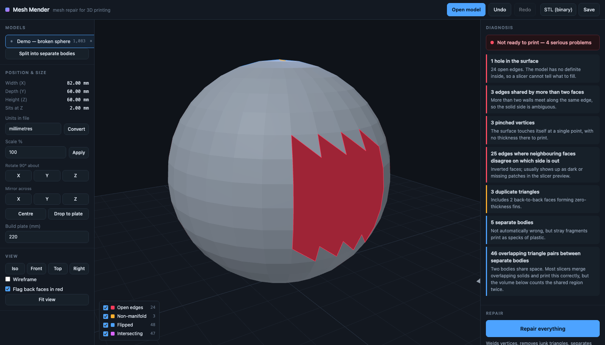

# Mesh Mender

Mesh repair for 3D printing, in the browser. A replacement for the repair tools
in Microsoft's 3D Builder, which was pulled from the Store.

It runs entirely on your own machine. There is no server, no account and no
upload — the model never leaves the browser tab.



## Running it

```sh
./serve.sh          # then open http://localhost:8173
```

or double-click `start.command` in Finder, which starts the server and opens
your browser.

A server is needed because the app is built from ES modules and a Web Worker,
and browsers refuse to load either over `file://`. Any static server will do;
`serve.sh` just uses the `python3` already on your Mac. Nothing is installed and
nothing is fetched at runtime: three.js and fflate are checked in under
`vendor/`, so the app works with the network off.

## What it reads and writes

| Format | Read | Write |
| --- | --- | --- |
| STL (binary and ASCII) | yes | yes |
| 3MF | yes | yes |
| OBJ | yes | yes |
| PLY (ASCII and binary) | yes | — |

The format is detected from the file's contents, so a mislabelled or
extension-less file still opens.

**Prefer 3MF when you can.** STL stores every triangle as three independent
corners with no record of which corners are the same point, which is why a
perfectly good model arrives looking like it has thousands of holes. 3MF stores
a real indexed mesh plus the units, so a model survives the round trip. Save a
repaired model as STL, load it again, and it will honestly report itself as
unwelded — not because the repair failed, but because the format threw the
topology away on the way out.

## What it fixes

Press **Repair everything** and it runs the lot, or open *Choose individual
fixes* to run one step at a time.

| Problem | What it means | What the repair does |
| --- | --- | --- |
| Duplicated vertices | Corners at the same point stored separately, so triangles only look joined | Welds them, within a tolerance you can set |
| Holes | Open edges, so the model has no definite inside | Fills each hole with a minimum-weight triangulation |
| Flipped faces | Neighbouring triangles disagree about which side is out | Floods each shell and re-winds the odd ones out |
| Inside-out model | Consistently wound, but every normal points inward | Detects it from the sign of the volume and turns the shell round |
| Non-manifold edges and pinched vertices | More than two walls on one edge, or two lumps meeting at a point | Pulls the fans apart so each surface is its own |
| Zero-area triangles | Repeated corners or slivers | Removes them |
| Duplicate faces | The same triangle twice, or back-to-back as a zero-thickness fin | Removes the repeats, and both halves of a fin |
| Stray shells | Specks of debris floating beside the model | Discards shells below a fraction of the largest |
| Self-intersections | Walls passing through each other | Reports them; cutting them out is opt-in and guarded, and rebuilding as a solid resolves the rest |

Every run prints a before/after table and a line for each step saying exactly
what it changed, so nothing happens to your model that you cannot see.

### Self-intersections are treated carefully

The tool separates two cases that most repair tools lump together:

- **A body passing through itself** is a real defect — the inside is undefined
  where the surface folds through its own wall.
- **Two separate bodies overlapping** is usually deliberate. Slicers merge
  overlapping solids, so the model prints correctly; only the reported volume
  double-counts the shared region.

Cutting intersections out deletes real geometry, so it is off by default, only
ever touches the first case, and abandons the attempt if it would remove more
than a quarter of the model. Without that guard the patches over each cut
intersect the next round of geometry and the tool quietly eats the model.

For anything the knife cannot reach — two bodies sharing space, or a surface
folded so far through itself that cutting would take half the model — there is
**Rebuild as a solid**.

## Rebuild as a solid (experimental)

Every other repair here edits the surface. Some damage does not respond to
editing: two solids that overlap have no local change that makes them one
coherent object. This mode stops editing and re-derives the surface from
scratch, which is the approach 3D Builder itself took.

1. Fire a ray along every line of a regular grid and count the crossings, to
   decide which grid points are inside the solid.
2. Extract a fresh surface along the inside/outside boundary.

What comes back is watertight, manifold and free of self-intersections **by
construction** — a surface built from an inside/outside field cannot be anything
else. Overlapping bodies come out merged into one solid, with the shared region
counted once instead of twice.

The count is a *winding number*, the signed number of crossings, not odd/even
parity. That is the whole reason the union works: a point inside two overlapping
solids has winding 2, which is still inside, where parity would call it outside
and punch a hole through exactly the region you were trying to merge. The same
property means an inside-out body (winding −1) comes out solid rather than
inverted.

**What it costs.** Every detail is resampled at the grid spacing, so sharp edges
soften and anything finer than one voxel disappears. The triangle count goes up
a lot — a model of a thousand triangles can come back as a few hundred thousand.
It is a sledgehammer, it is offered as one, and it is off by default. The
**Detail** setting controls the grid; the panel shows what it works out to in
millimetres for the model in front of you.

Use it when the surgical repairs have run and the diagnosis still reports walls
passing through each other. The app offers it at exactly that point.

## Looking at the damage

The overlay in the bottom-left corner highlights each kind of defect in the 3D
view, drawn through the model so a hole on the far side is still findable.
*Flag back faces in red* paints the inside of the surface bright red: if you can
see red, you are looking at a face pointing the wrong way.

## Working with several parts

A model made of separate bodies — or one you have put through *Split into
separate bodies* — lists each part on the left. Clicking a part selects it and
brings the camera to it, travelling rather than cutting so you can see where it
went. The selected part is marked with green corner brackets and the others fade
back, because a part small enough to need selecting is usually tucked inside or
behind its neighbour, and a solid neighbour hides the very thing you just
picked. *Fade other parts when one is selected* turns that off.

Everything in the right-hand panel — the diagnosis, the measurements, repair,
and saving — applies to the selected part alone.

## Getting it onto the plate

Units, scale, 90° rotations, mirroring, centring and dropping to the plate are
in the left panel, along with the build-plate size. `Ctrl/Cmd+Z` undoes, and
every repair and transform is undoable.

## Deploying it

The app is static — no backend, no build step, no database, no state. Anything
that can serve a folder will host it.

### Coolify

The repo carries a `Dockerfile` that copies the files into nginx, so:

1. **New Resource → Private Repository** and pick this repo. Coolify needs
   access: either install its GitHub App on the repo, or add the deploy key it
   offers under *Sources*.
2. **Build Pack:** `Dockerfile`. Leave the base directory as `/`.
3. **Port:** `80`.
4. **Health check path:** `/health` (the container answers `ok` there).
5. Set the domain you want and deploy.

Nothing else to configure. There are no environment variables, no volumes and
no migrations; a redeploy is just a new container.

If you would rather use Coolify's Docker Compose build pack, `docker-compose.yml`
is there too — point it at that file instead and it will publish the same image.

### Anywhere else

```sh
docker build -t mesh-mender .
docker run -p 8080:80 mesh-mender
```

Or skip Docker entirely and hand `index.html`, `css/`, `js/` and `vendor/` to any
static host — GitHub Pages, S3, Netlify, a folder behind Caddy. The only real
requirement is that `.js` files are served with a JavaScript content type, or
the browser will refuse to load the modules.

### A note on caching

The nginx config sends `Cache-Control: no-cache` for everything. That is
deliberate rather than lazy: the app is built from ES modules, and a browser
holding one stale module next to a fresh `index.html` gives you a broken page
rather than an old one. `no-cache` still lets the browser keep the file — it
just has to revalidate, and the answer is almost always a cheap 304.

## Layout

```
index.html          the page
css/style.css       all of the styling
js/app.js           UI wiring; owns the DOM and nothing else
js/viewer.js        three.js scene, overlays, camera
js/worker.js        owns the meshes; all geometry work happens here
js/mesh/            the repair library, free of any DOM dependency
  core.js           the indexed mesh
  topology.js       edge table, shells, boundary loops, non-manifold detection
  cleanup.js        welding, degenerate and duplicate removal
  orient.js         winding and normal direction
  holes.js          hole filling
  nonmanifold.js    fan splitting
  shells.js         separate bodies and debris
  bvh.js            bounding-volume hierarchy
  intersect.js      triangle-triangle intersection and the search over it
  analyze.js        the read-only diagnosis
  repair.js         the pipeline that orders all of the above
js/io/              STL, OBJ, PLY, 3MF readers and writers
test/run.mjs        the test suite
vendor/             three.js and fflate, checked in
Dockerfile          nginx image for deployment
deploy/nginx.conf   the server config it uses
docker-compose.yml  same thing via Compose
```

The geometry code has no DOM dependency precisely so it can be tested directly:

```sh
npm test
```

The suite checks the repairs against known-good answers (a repaired cube has a
volume of exactly 1), and checks the self-intersection search against an
independent brute-force implementation, pair for pair.

## Known limits

- Repair works on one model at a time. Load several and switch between them in
  the Models list.
- Very large holes (more than 250 edges) are closed with a fan from a new centre
  vertex rather than an optimal triangulation, which is quicker but plainer.
- Self-intersections are found and reported but only cut out when you ask.
  Overlapping bodies are merged only by *Rebuild as a solid*, which unions them
  by resampling — this is not an exact boolean, and it will not preserve sharp
  edges through the join.
- Rebuilding fills a diagonal pinch rather than cutting it, so a neck thinner
  than one voxel comes out solid rather than severed. That is the safer way to
  be wrong for printing, but it is a change to the model.
- Around 500k triangles the browser starts to feel it. Repair is roughly linear;
  the self-intersection scan is the expensive part and can be left off.
